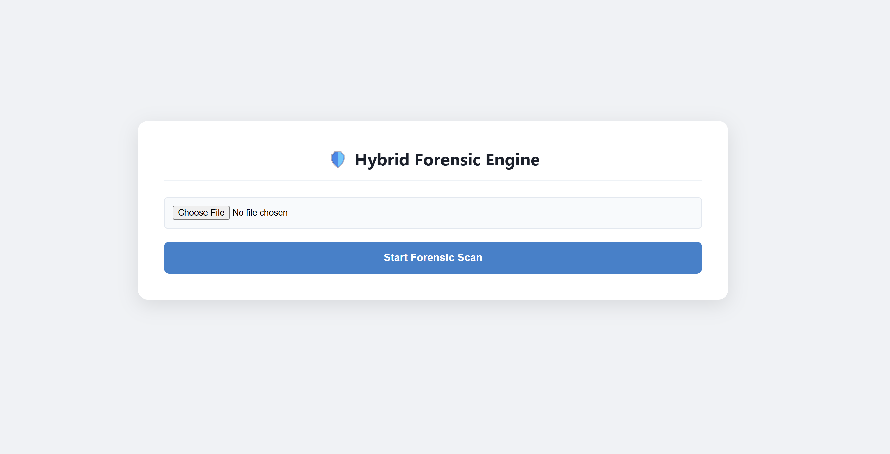
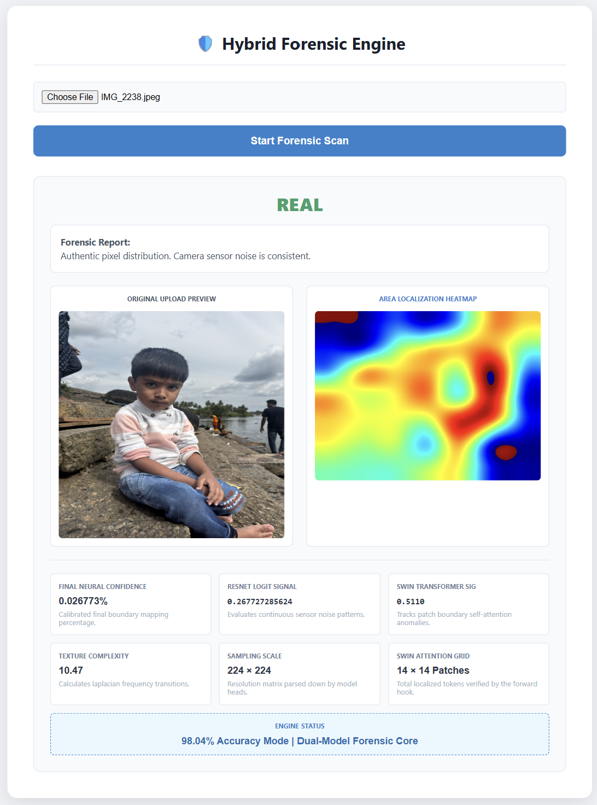
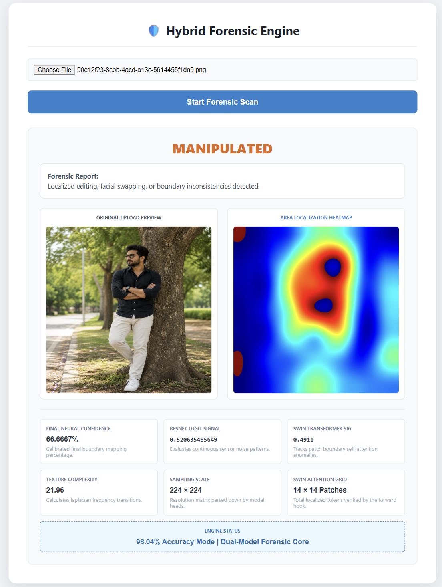

# 🔍 Deep Fake Detection System

An AI-powered deep learning web application designed to detect and classify authentic facial images from AI-generated or manipulated deepfakes using state-of-the-art vision architectures (**ResNet-50** and **Vision Transformers**).

---

## ⚡ Quick Start (3 steps)

### Step 1 — Clone the Repository

```bash
git clone https://github.com/YakeshKrishnanD/deepfake-image-detection-system.git
cd deepfake-image-detection-system

```

### Step 2 — Install Dependencies

```bash
pip install -r requirement.txt

```

### Step 3 — Run the Web App

```bash
python app.py

```

Open **http://localhost:5000** in your browser. Done!

---

## 🏗️ Build & Evaluation

```bash
# Evaluate hybrid model performance
python evaluate_hybrid.py

# Run CLI demonstration demo
python main_demo.py

```

---

## 🤖 AI & Model Architecture

| Setting | Value |
| --- | --- |
| **Primary Architectures** | ResNet-50 & Vision Transformer (ViT) |
| **Calibration Logic** | Hybrid Calibrator (`.joblib` / `.pkl`) |
| **Threshold Optimization** | Empirically optimized via `best_threshold.txt` |
| **Core Frameworks** | PyTorch, Torchvision, Flask, Gradio |

---

## 📋 Features

| Feature | Description |
| --- | --- |
| **Multi-Model Pipeline** | Combines convolutional feature extraction with transformer-based global attention |
| **Hybrid Scoring** | Calibrated prediction blending for maximized forgery detection accuracy |
| **Interactive UI** | Clean Flask web interface with image upload and live prediction feedback |
| **Testing Suite** | Pre-configured benchmarking images split into `ORIGINAL` and `TAMPERED` categories |
| **Colab Integration** | Step-by-step Jupyter notebooks for training and model fine-tuning |

---

## 🗂️ Project Structure

```text
sample-deepfake-project/
├── .gitignore                    ← Keeps heavy weight files ignored
├── app.py                        ← Flask web application backend
├── main_demo.py                  ← CLI execution demo
├── evaluate_hybrid.py            ← Evaluation pipeline script
├── best_threshold.txt            ← Optimized classification threshold
├── requirement.txt               ← Python dependencies
├── LICENSE                       ← Project license
├── Models/                       ← Model binaries & calibration weights
│   ├── hybrid_calibration_logic.pkl
│   ├── hybrid_calibrator.joblib
│   ├── resnet_50.pkl             (~197 MB - Hosted/Local)
│   └── vision_transformer.pkl    (~111 MB - Hosted/Local)
├── colab/                        ← Training & experimentation notebooks
│   ├── 98_04_hybrid.ipynb
│   ├── VIT.ipynb
│   ├── fake_image_detection.ipynb
│   └── hybrid_model.ipynb
├── templates/                    ← Frontend UI
│   └── index.html
├── outputs/                      ← UI layout & results visualizations
│   ├── Landingpage.png
│   ├── Manuplated.png
│   ├── Real.png
│   └── Synthetic.png
└── testing images/               ← Evaluation dataset
    ├── ORIGINAL/                 ← Genuine reference samples
    └── TAMPERED/                 ← Manipulated deepfake test images

```

---

## 🏗️ System Architecture

The following diagram illustrates the complete end-to-end data flow, module breakdown, and database storage structure of the Deep Fake Detection System:

[cite: 5]

---

## 🎓 Demo Flow (For Presentation)

1. Run `python app.py` and open `http://localhost:5000` in your browser.
2. View the **Landing Page** dashboard interface.
3. Upload an image from the `testing images/` directory (choose between `ORIGINAL` or `TAMPERED`).
4. Click evaluate to let the hybrid **ResNet-50 + ViT** model process the input.
5. Review the classification result, confidence score, and calibrated prediction breakdown.

---

## 🖥️ Screenshots & Visual Interface

### 🌐 1. Application Landing Page & Interface



### 🟢 2. Authentic Image Detection Result (Real)



### 🔴 3. Deepfake Manipulation Detection (Manipulated)



### 📊 4. Deepfake synthetic Detection (Synthetic)


---

## 👨‍💻 Author

**Yakesh Krishnan D**

Deep Fake Detection System — Advanced media authentication and computer vision security workflows.

⭐ If you find this project useful, consider giving the repository a star.
